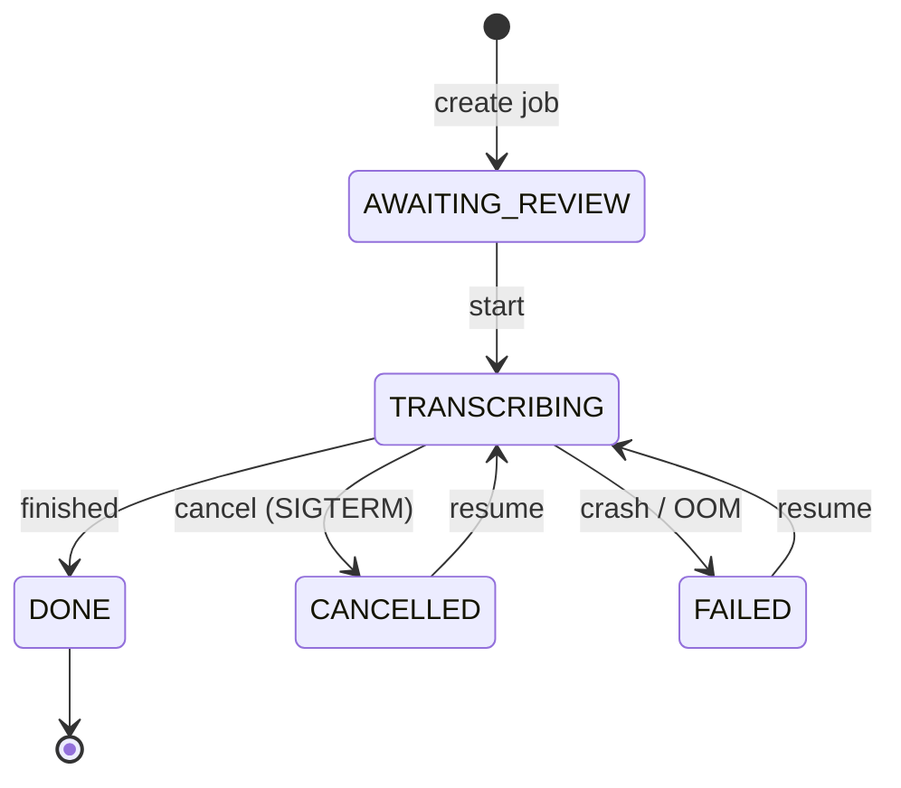

> epub2tts-chatterbox is a free and open source Python app to easily create a full-featured audiobook from an EPUB or text file using realistic voice-cloning text-to-speech by [Chatterbox](https://github.com/resemble-ai/chatterbox). A CUDA-compatible GPU is required, or Apple Silicon.

## 👤 Attribution

This project is a **fork** of [aedocw/epub2tts-chatterbox](https://github.com/aedocw/epub2tts-chatterbox) by
**[Christopher Aedo](https://aedo.dev)** (GitHub: [@aedocw](https://github.com/aedocw)), who wrote the
core EPUB→audiobook pipeline and Chatterbox integration. All credit for the original tool goes to him.

The upstream repository is currently **not accepting issues or pull requests**, which is why this fork
exists. It builds on the original to add:

- 🌐 **Web UI** (FastAPI + HTMX): browse books, pick a speaker sample, create jobs, edit chapters,
  watch live progress, download the M4B — no command line needed
- 🐳 **Production Docker image** serving the web UI, plus a **`docker-compose.yml`** for one-command
  deployment with GPU passthrough
- 🐛 **Bug fixes** and improvements (e.g. bounded-memory chapter assembly, fixed silence pruning,
  FFmetadata escaping, chapter-title alignment, GPU-aware precision)

The original CLI remains fully usable, including inside the Docker image.

## 🚀 Features

- Creates standard format M4B audiobook file (AAC + chapter metadata + embedded cover art)
- Automatic chapter break detection (TOC / headings / CSS classes / fallback)
- Embeds cover art if specified
- **Resumes where it left off** if interrupted (per-paragraph/checkpoint FLACs)
- Web UI (browse books, pick a sample, watch live progress) in the Docker image
- Job supervisor: one job at a time, cancel/resume, crash recovery
- GPU-aware precision: bf16 on Ampere+ (e.g. 4060 Ti), fp32 on Pascal (e.g. 1080/2080) — automatic
- NOTE: EPUB files must be DRM-free

## 🏗️ Architecture

A **single GPU container** runs everything:

```mermaid
flowchart TB
    subgraph CONTAINER["Single GPU container"]
        subgraph WEB["FastAPI app (uvicorn, :8080)"]
            UI["Web UI pages<br/>(Jinja2 + HTMX)<br/>/ · /jobs · /jobs/&#123;id&#125;"]
            API["REST API<br/>/api/books · /api/samples · /api/jobs…"]
            SUP["Job supervisor<br/>(async loop, single-job lock)"]
        end
        CLI["epub2tts-chatterbox (CLI subprocess)<br/>EPUB → book.txt (epub_export)<br/>text → Chatterbox TTS (GPU)<br/>ffmpeg: concat + silence pruning → partN.flac<br/>ffmpeg: metadata → .m4b (+ cover)"]
    end

    subgraph DATA["/data (bind mount)"]
        BOOKS["<book-folder>/*.epub<br/>source books"]
        SAMPLES["speaker/*.wav|mp3<br/>voice-cloning samples"]
        JOBS["jobs/&#123;job-id&#125;/<br/>book.txt · checkpoints · logs · .m4b"]
    end

    UI --> SUP
    API --> SUP
    SUP -- "spawns one subprocess per job (cwd = job dir)" --> CLI
    BOOKS -- "EPUB input" --> CLI
    SAMPLES -- "speaker sample" --> CLI
    CLI -- "state.json · progress.json · partN.flac · .m4b" --> JOBS
```



Job lifecycle:



Key design points:

- **Files as state** — each job is a directory under `/data/jobs/` containing `state.json`
  (job state/metadata) and `progress.json` (hot progress file). No database.
- **Subprocess jobs** — each TTS run is the original CLI launched with `cwd` = the job dir,
  so all intermediates (`partN.flac`, `pgraphs*.flac`, …) live in the job dir and cleanup is
  trivial. This keeps job lifetime decoupled from the web process.
- **Single-job lock** — one job can transcribe at a time (fits one GPU); starting another
  returns `409` while busy.
- **Crash/cancel resumable** — completed chapters exist as `partN.flac` and are skipped on
  re-run. On server restart, orphaned `TRANSCRIBING` jobs are marked `FAILED` (resumable).
- **GPU-aware precision** — at startup the app reads the GPU compute capability: Ampere+
  (cc ≥ 8) gets bf16 autocast + TF32; older cards (Pascal/Volta) stay on native fp32.
  No configuration needed.
- **Live progress** — the supervisor tails the subprocess stdout (tqdm lines), writes
  `progress.json` every ~2 s; the UI updates via SSE/polling.

## 📦 Install & Use

### Option A — Docker (recommended)

Requirements: Linux host with an **NVIDIA GPU** + [NVIDIA Container Toolkit](https://docs.nvidia.com/datacenter/cloud-native/container-toolkit/latest/installation-guide.html).

```bash
git clone <this-repo> && cd epub2tts-chatterbox
docker build -t epub2tts-chatterbox:local .
```

#### With Docker Compose (one command)

Edit the two bind-mount paths in [`docker-compose.yml`](./docker-compose.yml) to your
locations, then:

```bash
docker compose up -d
```

Open the web UI at **`http://<host>:8080`**.

#### With plain `docker run`

```bash
docker run -d \
  --name epub2tts-chatterbox \
  --gpus all \
  -e NVIDIA_VISIBLE_DEVICES=all \
  -e NVIDIA_DRIVER_CAPABILITIES=compute,utility \
  -e HF_HOME=/root/.cache/huggingface \
  -v /path/to/books:/data \
  -v /path/to/model-cache:/root/.cache/huggingface \
  -p 8080:8080 \
  epub2tts-chatterbox:local
```

#### Data layout (the `/data` bind mount)

| Path | Purpose |
|---|---|
| `/data/<folder>/*.epub` | Books to browse in the UI (one subfolder per collection) |
| `/data/speaker/*.wav\|mp3` | Speaker samples for voice cloning (30–60 s, clean audio, no background noise) |
| `/data/jobs/` | Job dirs (created automatically): `book.txt`, checkpoints, logs, final `.m4b` |

The HuggingFace cache mount (`/root/.cache/huggingface`) is where the Chatterbox model
(~several GB) is downloaded on first run — keep it on a persistent path so rebuilds don't
re-download it.

### Using the Web UI

1. **Home** (`/`) — pick a book folder + EPUB, a speaker sample, optional TTS parameters
   (exaggeration, CFG weight, read-titles flag) → **Create job**
2. **Job page** — review the extracted text and chapter names, edit titles/text if needed
   (remove front matter like the table of contents, rename `#` chapter headings)
3. **Start** — transcription begins; progress bar, current chapter, and ETA update live
4. **Cancel / Resume** — canceling keeps checkpoints; starting again skips completed chapters
5. **Done** — download the M4B (with chapter markers and cover art)

### Option B — Native install (CLI only)

Requires Python 3.12 (3.11 works on Mac), `ffmpeg`, `espeak-ng`.

**Linux (Ubuntu 22.04/24.04):**
```bash
sudo apt install espeak-ng ffmpeg python3-venv
git clone <this-repo> && cd epub2tts-chatterbox
python3 -m venv .venv && source .venv/bin/activate
pip install .
```

**macOS (Homebrew + pyenv):**
```bash
brew install mecab espeak pyenv ffmpeg
git clone <this-repo> && cd epub2tts-chatterbox
pyenv install 3.11 && pyenv local 3.11
python -m venv .venv && source .venv/bin/activate
pip install .
```

**First run** downloads the NLTK tokenizers (~50 MB). To control where they go:
`export NLTK_DATA="your/path/to/nltk_data"`. The Chatterbox model is downloaded from
HuggingFace on first TTS run (cached in `HF_HOME`).

### CLI usage (two phases)

**Phase 1 — extract EPUB to text** (edit the result before continuing):
```bash
epub2tts-chatterbox mybook.epub
# → mybook.txt (+ mybook.png if a cover was found)
# Edit mybook.txt: first two lines may be "Title:" / "Author:",
# "# Chapter N" lines mark chapters, remove anything you don't want read.
```

**Phase 2 — text to audiobook** (writes to the *current working directory*):
```bash
epub2tts-chatterbox mybook.txt --cover mybook.png --sample speaker.wav
# → "mybook (speaker).m4b"
```

| Argument | Meaning |
|---|---|
| `sourcefile` | `.epub` (phase 1) or `.txt` (phase 2) |
| `--sample FILE` | Speaker sample (WAV/MP3, ideally 30–60 s, clean) |
| `--cover FILE` | Cover image (jpg/png) to embed |
| `--notitles` | Don't read chapter titles aloud |
| `--no-prune` | Disable silence pruning |
| `--exaggeration FLOAT` | Voice-cloning exaggeration (default `0.7`) |
| `--cfg_weight FLOAT` | Chatterbox CFG weight (default `0.4`) |
| `--naming CHOICE` | EPUB chapter naming: `auto` (default), `toc`, `heading`, `class`, `fallback` |

Killing a run mid-way is safe — re-running in the same directory resumes from checkpoints.

## 🔄 Updating

```bash
git pull
# native install:
source .venv/bin/activate && pip install . --upgrade
# docker:
docker build -t epub2tts-chatterbox:local . && docker compose up -d
```

## 📝 Environment variables

| Variable | Default | Purpose |
|---|---|---|
| `EPUB2TTS_DATA` | `/data` | Data root for books/samples/jobs (web UI) |
| `HF_HOME` | — | HuggingFace model cache location |
| `NLTK_DATA` | — | Where NLTK tokenizers (~50 MB) are stored |

## 🗒️ Release notes

- **2026-10-29** — Job delete button fixed (frontend); bounded-memory chapter build
  (streaming ffmpeg, flat RAM) + fixed silence pruning; `--no-prune` flag; ffmetadata escaping
- **2026-10-26** — Web UI (FastAPI + HTMX) + job supervisor; GPU-aware precision
  (bf16 on Ampere+, fp32 on Pascal); production Dockerfile serving the web UI on :8080;
  web deps added to `requirements.txt`; `docker-compose.yml`
- 2025-02-24 — Read individual sentences rather than entire paragraphs
- 2025-02-21 — Added `--notitles` option
- 2025-02-16 — Initial release (upstream)

## 🐞 Reporting bugs

Please file issues in **this** repository (the upstream project is not accepting issues/PRs).
Include:
1. The full command you executed (or the UI steps taken)
2. The platform (Linux, Windows, macOS, Docker) and GPU model
3. Python version if not using Docker
4. Relevant log output (`/data/jobs/<id>/stdout.log` for web UI jobs)

## 👥 Contributors

Original author: [Christopher Aedo](https://aedo.dev) — [@aedocw](https://github.com/aedocw)

Give a ⭐️ if this project helped you!
